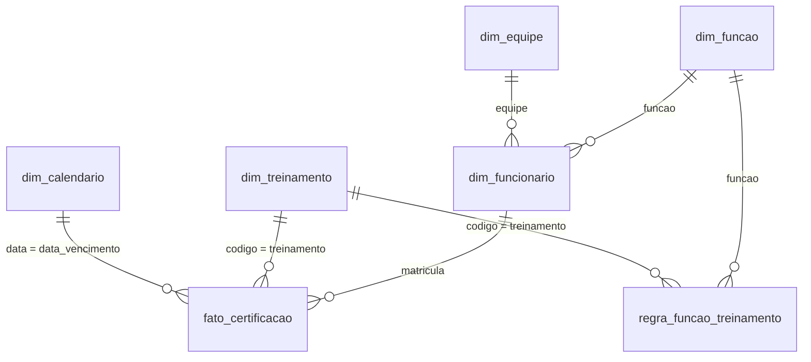

# Modelo de dados do painel

O painel usa um modelo em estrela: no centro, uma tabela de fatos com uma linha por emissão de treinamento; em volta, as tabelas que descrevem quem, o quê e quando. Cada tabela sai de uma consulta Power Query de [`powerquery/`](../powerquery) com o mesmo nome. As medidas estão em [`dax/medidas.dax`](../dax/medidas.dax), e o passo a passo para montar tudo, em [MONTAGEM.md](MONTAGEM.md).

`parametro`, `qualidade_rejeicoes` e `Medidas` ficam soltas, sem relacionamento (ver abaixo por quê).

## Tabelas

As colunas marcadas com * não existem na versão limpa em CSV: são calculadas no Power Query para as medidas e os visuais ficarem simples. As demais são iguais, coluna a coluna, às de [`data/limpa/`](../data/limpa), e o teste `tests/test_powerbi.py` confere isso.

### `dim_funcionario`

Uma linha por matrícula. Sai da aba `Controle`; quando a matrícula se repete, fica a primeira linha.

| Coluna | Tipo | O que é |
|---|---|---|
| `matricula` | número inteiro | chave |
| `nome` | texto | |
| `funcao` | texto | liga em `dim_funcao` |
| `equipe` | texto | liga em `dim_equipe` |
| `admissao` | data | |
| `situacao` | texto | `Ativo` ou `Desligado`; as medidas contam só ativos |
| `desligamento` | data | vazia para quem está ativo |
| `funcionario`* | texto | "7001 - Nome": rótulo das linhas da matriz, que não junta homônimos |

### `dim_funcao`

Uma linha por função que tem regra. Sai da aba `Regra_Funcao_Treinamento`.

| Coluna | Tipo | O que é |
|---|---|---|
| `funcao` | texto | chave |

### `dim_equipe`

Uma linha por equipe que aparece no cadastro. Existe para o filtro de equipe, que assim mostra cada equipe uma vez.

| Coluna | Tipo | O que é |
|---|---|---|
| `equipe` | texto | chave |

### `dim_treinamento`

Uma linha por treinamento ou exame, da aba `Treinamentos`.

| Coluna | Tipo | O que é |
|---|---|---|
| `codigo` | texto | chave: ASO, NR01, NR35... |
| `nome` | texto | "NR-35: trabalho em altura" |
| `validade_meses` | número inteiro | por quantos meses a emissão vale; 0 = não vence |
| `ordem`* | número inteiro | posição na planilha, para ordenar as colunas da matriz |

### `regra_funcao_treinamento`

Uma linha por par função e treinamento, da aba `Regra_Funcao_Treinamento` despivotada.

| Coluna | Tipo | O que é |
|---|---|---|
| `funcao` | texto | liga em `dim_funcao` |
| `treinamento` | texto | liga em `dim_treinamento` |
| `regra` | texto | `SIM` (obrigatório), `NÃO` (não se aplica) ou `CONDICIONAL` |

### `fato_certificacao`

Uma linha por emissão: as datas da aba `Controle`, despivotadas, mais as emissões anteriores da aba `Historico`.

| Coluna | Tipo | O que é |
|---|---|---|
| `matricula` | número inteiro | liga em `dim_funcionario` |
| `treinamento` | texto | liga em `dim_treinamento` |
| `data_emissao` | data | |
| `origem` | texto | `Controle` ou `Historico` |
| `data_vencimento`* | data | emissão + validade; vazia quando não vence. Liga em `dim_calendario` |
| `vigente`* | verdadeiro/falso | verdadeiro na emissão mais recente do funcionário naquele treinamento |
| `regra`* | texto | a regra da função do funcionário para esse treinamento |

### `dim_calendario`

Um dia por linha, de 1º de janeiro do primeiro ano com emissão ou vencimento até 31 de dezembro do último.

| Coluna | Tipo | O que é |
|---|---|---|
| `data` | data | chave; marque a tabela como tabela de datas por esta coluna |
| `ano` | número inteiro | |
| `mes` | número inteiro | 1 a 12 |
| `mes_ano` | texto | "nov/2026"; classificado por `ano_mes` |
| `ano_mes` | número inteiro | 202611 |
| `meses_da_referencia` | número inteiro | 0 no mês da data de referência, 1 no seguinte |

### `parametro`

Uma linha só, da aba `Alertas`: `data_referencia`, `janela_1`, `janela_2` e `janela_3` (em dias).

### `qualidade_rejeicoes`

Uma linha por coisa descartada na limpeza: `aba`, `linha` (no Excel), `matricula`, `coluna`, `valor_original`, `motivo` e `acao`.

### `Medidas`

Tabela vazia, com uma coluna `oculta`. Só guarda as medidas.

## Relacionamentos

Todos são de um para muitos, com o filtro indo do lado "um" para o lado "muitos" (direção única), e todos ficam ativos.

| Muitos | Um | Por quê |
|---|---|---|
| `dim_funcionario[funcao]` | `dim_funcao[funcao]` | filtrar uma função filtra os funcionários dela e, por eles, as emissões |
| `dim_funcionario[equipe]` | `dim_equipe[equipe]` | o filtro de equipe |
| `fato_certificacao[matricula]` | `dim_funcionario[matricula]` | as emissões de cada funcionário |
| `fato_certificacao[treinamento]` | `dim_treinamento[codigo]` | as emissões de cada treinamento |
| `regra_funcao_treinamento[funcao]` | `dim_funcao[funcao]` | o que cada função exige |
| `regra_funcao_treinamento[treinamento]` | `dim_treinamento[codigo]` | quem precisa de cada treinamento |
| `fato_certificacao[data_vencimento]` | `dim_calendario[data]` | o eixo do gráfico de vencimentos por mês |

## Por que o modelo é assim

**A regra é uma tabela à parte, e não uma coluna da fato.** "Itens obrigatórios" conta também o que não tem emissão nenhuma: o funcionário que nunca fez a NR-35 não tem linha em `fato_certificacao`. Por isso a medida conta, para cada função, os funcionários ativos vezes as regras `SIM` daquela função. A fato sozinha não sabe o que falta.

**A fato também traz a regra.** Para contar o que vence ou venceu, a medida olha as emissões e precisa saber se aquele item é obrigatório, condicional ou não se aplica. Trazer a regra para a linha da emissão, no Power Query, evita uma busca a cada cálculo.

**Só a emissão vigente conta.** O histórico fica na fato (dá para ver quem refez o quê), mas as medidas de situação usam só `vigente = verdadeiro`: a NR-35 de 2021 não deixa ninguém vencido se a de 2024 está em dia.

**Os filtros não voltam.** Com direção única, filtrar um treinamento não filtra os funcionários. É o comportamento esperado ("quantos ativos" não muda quando se escolhe a NR-35), e evita caminhos ambíguos entre `dim_funcao`, `dim_treinamento` e as duas tabelas do meio.

**`parametro` fica solta.** É uma linha só; as medidas leem a data de referência e as janelas com `MAX(parametro[...])`. Ligá-la a outra tabela não acrescentaria nada.

**`qualidade_rejeicoes` fica solta.** É a lista do que não entrou no modelo; ela não descreve emissão nenhuma e só alimenta a página de qualidade.

**O calendário liga no vencimento, e não na emissão.** A pergunta do painel é "o que vence quando". Uma segunda ligação, pela emissão, teria de ficar inativa e ser ligada à mão com `USERELATIONSHIP`; nenhuma pergunta do spec precisa dela.
